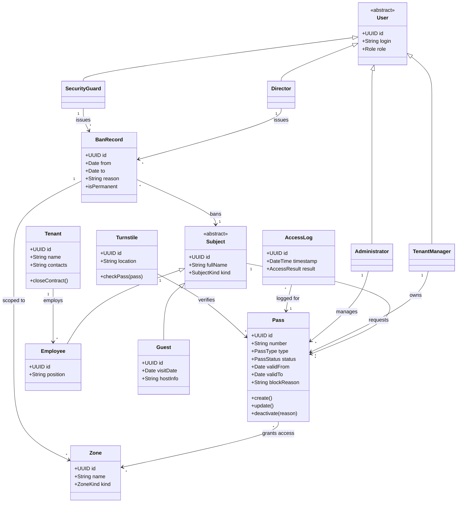
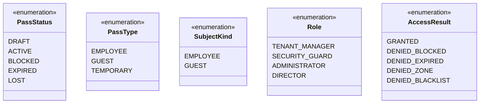
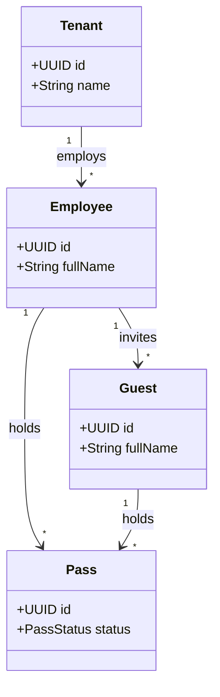

# Диаграмма классов — Система управления доступом БЦ

Модель предметной области и роли. Формат **Mermaid** (рендерится на GitHub).

---

## 1. Диаграмма классов (основная модель)

---

## 2. Перечисления (Enums)

---

## 3. Связи владельца пропуска с арендатором

