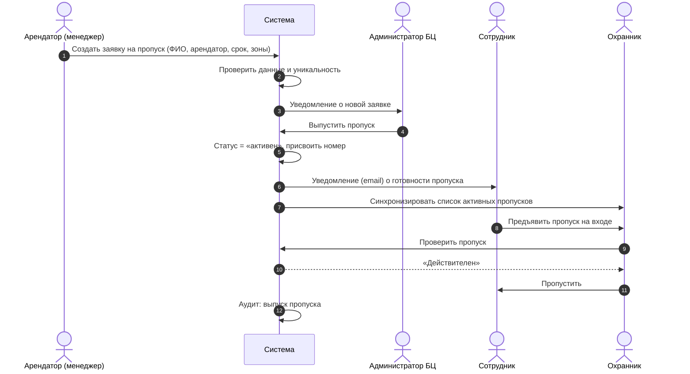
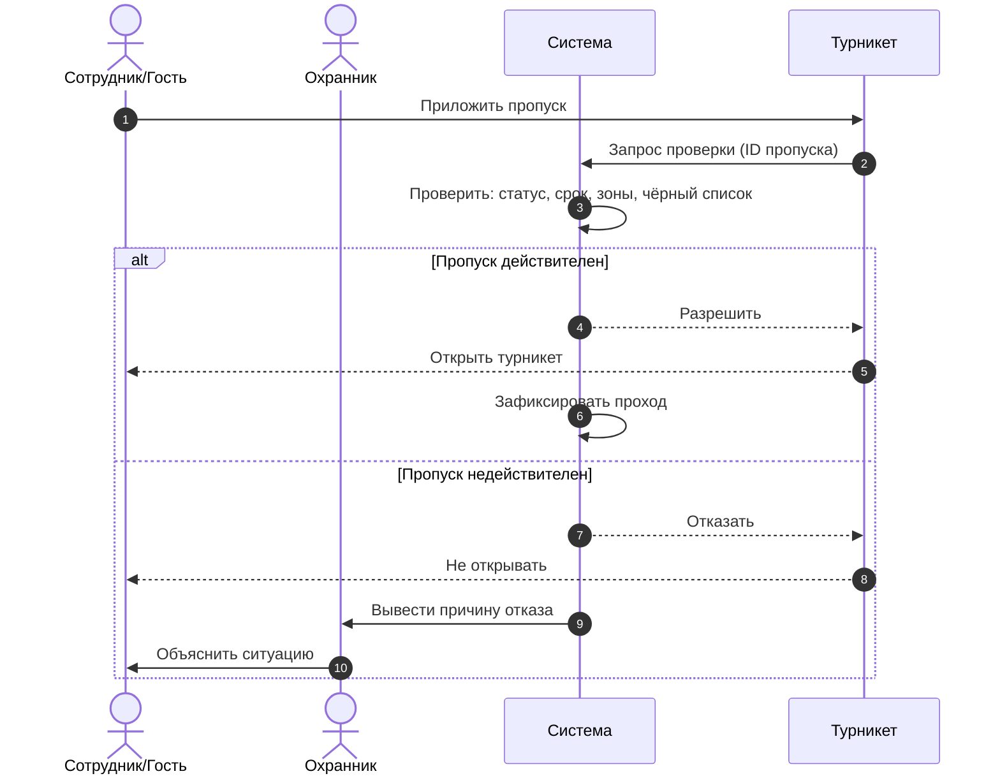
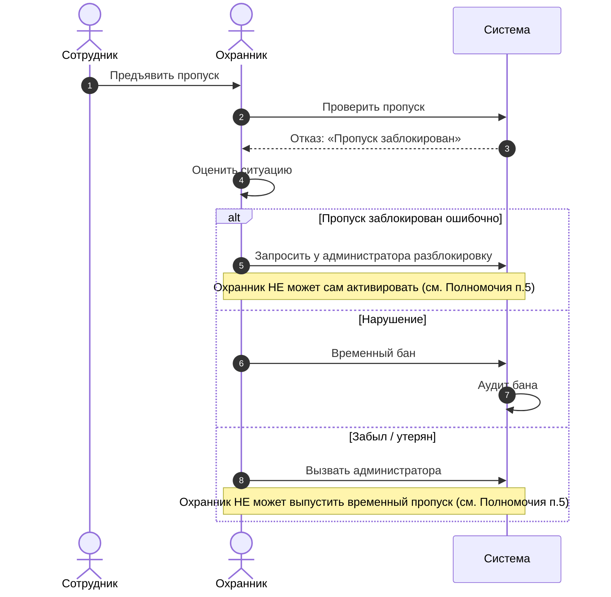
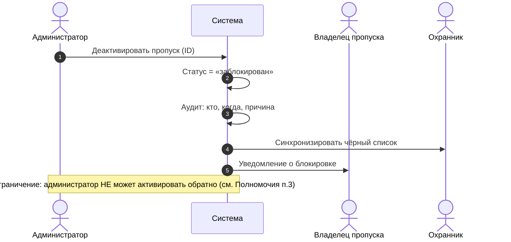
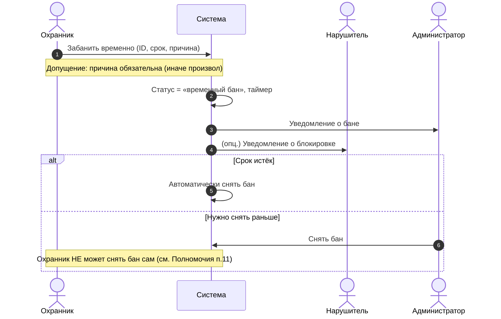
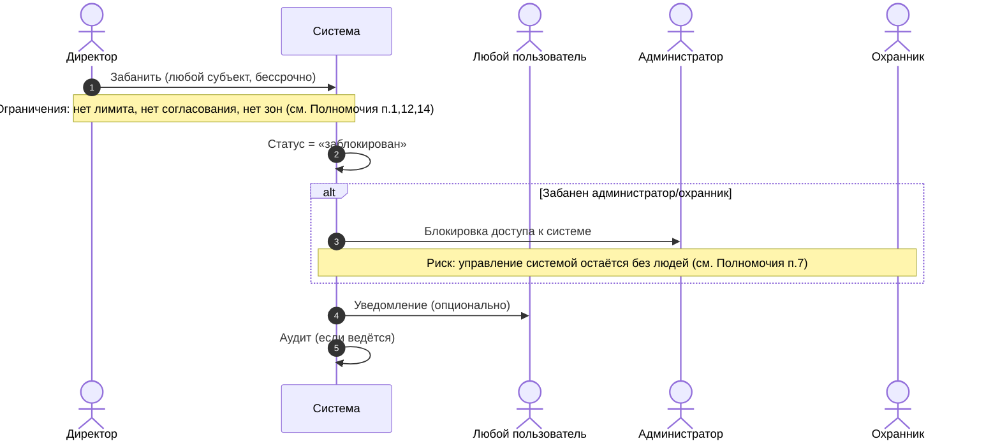
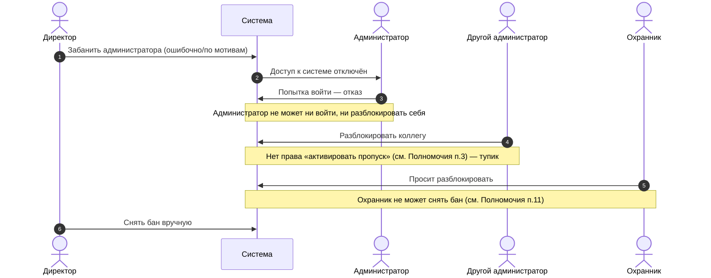
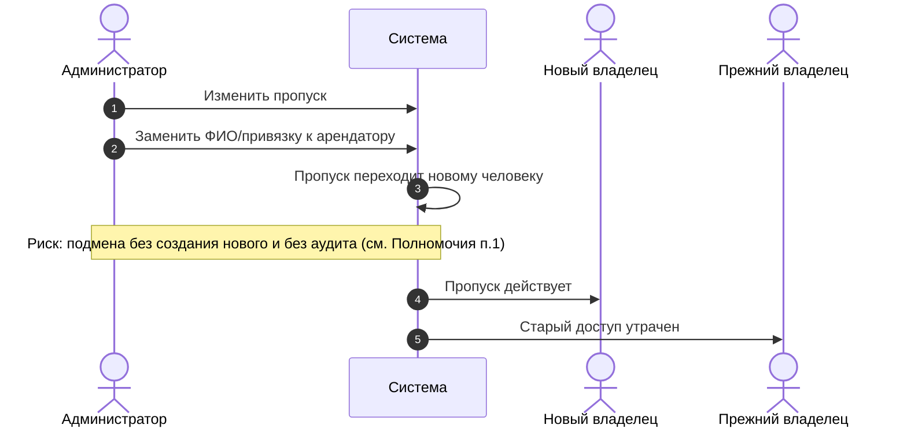
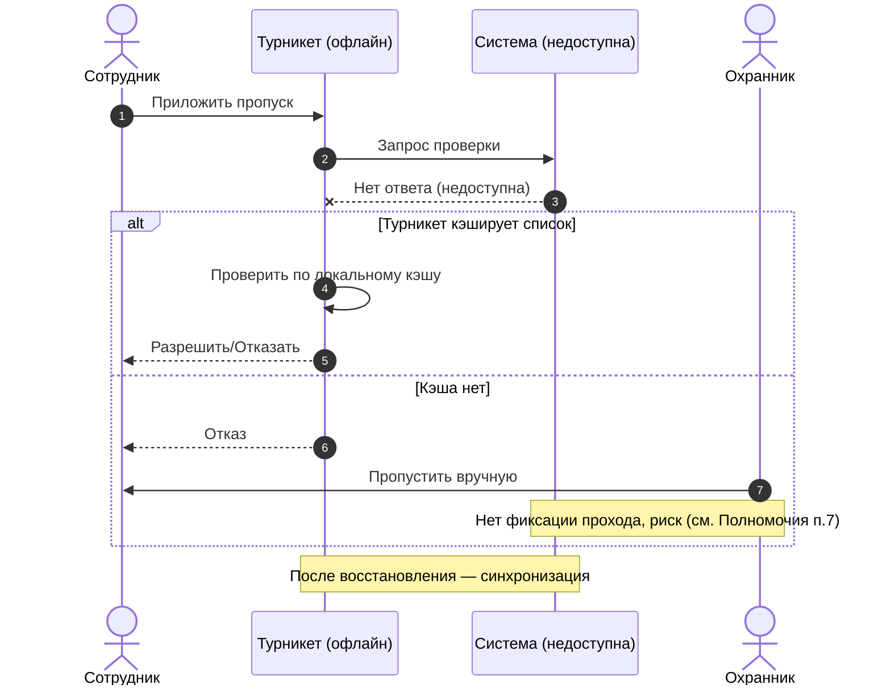

# Диаграммы последовательности — Система управления доступом БЦ

Роли: **Арендатор/Сотрудник**, **Охранник**, **Администратор**, **Директор**, **Турникет (СКУД)**, **Система**.

Ниже — ключевые сценарии. Каждая диаграмма в формате **Mermaid** (рендерится на GitHub) и продублирована комментарием с альтернативой.

---

## 1. Выпуск пропуска сотруднику (happy path)



---

## 2. Проход по пропуску (успешный)



---

## 3. Проход при недействительном пропуске (отказ)



---

## 4. Блокировка (деактивация) пропуска администратором



---

## 5. Временный бан охранником



---

## 6. Бан директором (кого угодно, бессрочно)



---

## 7. Ошибочная блокировка → восстановление доступа

Показывает конфликт полномочий: администратора заблокировали, а разблокировать некому.



---

## 8. Действие, которого не должно быть: администратор переписывает владельца



---

## 9. Обход контроля: проход «хвостом» и по чужому пропуску

```mermaid
sequenceDiagram
    autonumber
    actor E1 as Сотрудник (с пропуском)
    actor E2 as Посторонний (без пропуска)
    participant T as Турникет
    participant S as Система
    actor G as Охранник

    E1->>T: Приложить пропуск
    T->>S: Проверка
    S-->>T: Разрешить
    T-->>E1: Открыть
    E1->>T: Пройти
    E2->>T: Пройти следом («хвост»)
    Note over T,E2: Турникет открылся один раз — прошли двое
    Note over G,S: Система не видит второго; ochrana решает вручную
```

---

## 10. Отказ системы (офлайн-режим турникета)



---

## Сводка соответствия ролей и полномочий

| Роль | Может | Ограничения (из Полномочия.txt) |
|---|---|---|
| Арендатор/Сотрудник | Проход по пропуску | Нет альтернативы при утере/забыл (п.8,9,10) |
| Охранник | Временный бан, проверка | Не активирует, не оформляет гостя, не снимает бан (п.5,11,12) |
| Администратор | Создать, изменить, деактивировать | Не активирует обратно, нет аудита/удаления (п.3,12,13) |
| Директор | Забанить кого угодно, проход | Нет лимита, согласования, делегирования (п.11–15) |
