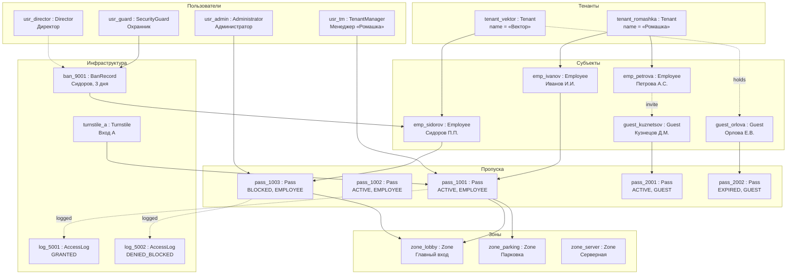
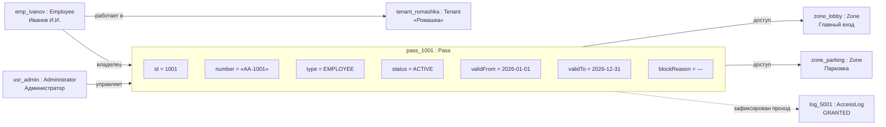
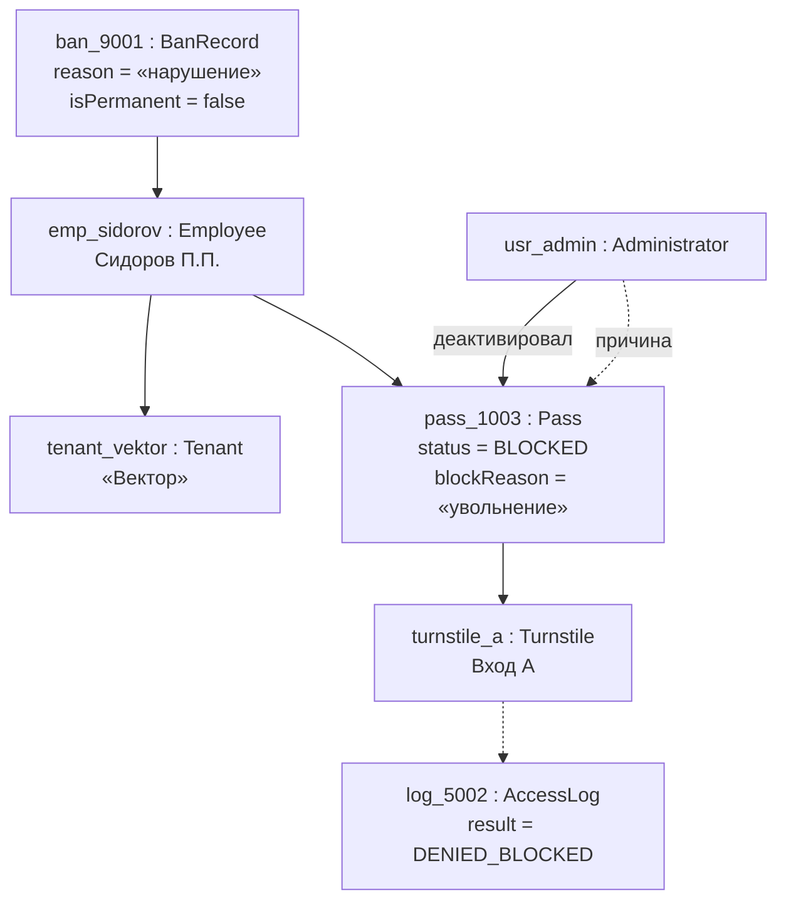
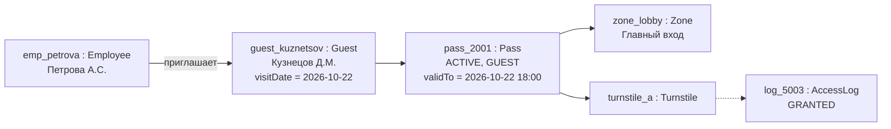
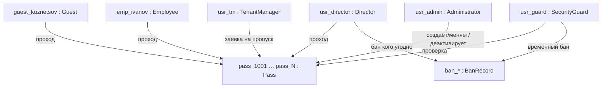

# Объектная модель — Система управления доступом БЦ

Конкретные экземпляры (объекты) предметной области и связи между ними.
Формат **Mermaid** (рендерится на GitHub).

Объект записан как `имяОбъекта : Класс` с текущими значениями атрибутов.

---

## 1. Обзорная карта объектов

---

## 2. Объект «пропуск» и его окружение (детально)

---

## 3. Сценарий: заблокированный пропуск Сидорова

---

## 4. Гостевой визит (объекты одного дня)

---

## 5. Роли-пользователи и их объекты-действия

---

## Таблица объектов (пример набора)

| Объект | Класс | Ключевые значения |
|---|---|---|
| tenant_romashka | Tenant | «Ромашка» |
| tenant_vektor | Tenant | «Вектор» |
| emp_ivanov | Employee | Иванов И.И., «Ромашка» |
| emp_petrova | Employee | Петрова А.С., «Ромашка» |
| emp_sidorov | Employee | Сидоров П.П., «Вектор» |
| guest_kuznetsov | Guest | Кузнецов Д.М., визит 2026-10-22 |
| guest_orlova | Guest | Орлова Е.В. |
| pass_1001 | Pass | ACTIVE, EMPLOYEE, до 2026-12-31 |
| pass_1002 | Pass | ACTIVE, EMPLOYEE |
| pass_1003 | Pass | BLOCKED, причина «увольнение» |
| pass_2001 | Pass | ACTIVE, GUEST, на день |
| pass_2002 | Pass | EXPIRED, GUEST |
| usr_admin | Administrator | управляет пропусками |
| usr_guard | SecurityGuard | временный бан, проверка |
| usr_director | Director | бан кого угодно, проход |
| usr_tm | TenantManager | заявки «Ромашка» |
| zone_lobby | Zone | Главный вход |
| zone_parking | Zone | Парковка |
| zone_server | Zone | Серверная |
| turnstile_a | Turnstile | Вход A |
| log_5001 / 5002 / 5003 | AccessLog | GRANTED / DENIED_BLOCKED |
| ban_9001 | BanRecord | Сидоров, 3 дня |
